# BrandGuard Prototype Architecture and Evidence Flow

## Scope

BrandGuard is a human-reviewed prototype for assessing submitted social
profiles, websites, and app listings against an organization's brand profile.
It is not a continuous discovery, enforcement, or takedown service. The diagram
below distinguishes working data paths from integrations that are not
implemented.

## Architecture diagram

```mermaid
flowchart LR
  subgraph inputs["Candidate inputs"]
    Dashboard["Dashboard<br/>Analyst-submitted profile or listing"]
    Extension["Chrome extension<br/>User-selected active-tab URL"]
    Apple["Apple public catalog<br/>Search on request"]
    SocialAPI["Social platform APIs / crawlers<br/>Not connected"]
    Play["Google Play catalog search<br/>Not connected"]
  end

  subgraph app["BrandGuard application"]
    API["FastAPI REST API<br/>Authentication and organization scope"]
    Profile["Brand profile<br/>Names, aliases, logo URL, official assets"]
    Trust["Trusted-asset gate<br/>Only assets marked verified are compared"]
    Detect["Detection pipeline<br/>Normalization, similarity, domain checks,<br/>rules, optional tabular model"]
    Evidence["Risk assessment<br/>Evidence, missing data, uncertainty, model version"]
    Review["Dashboard history<br/>Analyst verdict and feedback"]
  end

  subgraph persistence["Configured database"]
    DB[("Brands, assets, scans,<br/>source provenance, features,<br/>assessments, evidence, reviews and audit events")]
  end

  Dashboard -->|"Submitted details"| API
  Extension -->|"Submitted URL"| API
  Apple -->|"Search result metadata; analyst chooses listing"| Dashboard
  Profile -->|"Verified official identifiers"| Trust
  API -->|"Candidate + selected brand"| Detect
  Trust --> Detect
  Detect --> Evidence
  Evidence --> DB
  Profile --> DB
  DB --> Review
  Review -->|"Review / feedback is persisted"| DB
  SocialAPI -. "Future: approved, permissioned discovery" .-> API
  Play -. "Future: approved catalog integration" .-> API
```

The browser dashboard and extension send analyst-selected data to the API.
Apple catalog search is a separate on-demand API request; returned metadata
is only an observation and is not proof of ownership. A selected Apple result
is saved with listing ID, source URL, client-reported observation time, and
server receipt time. The API analyzes submitted details, compares them with
the selected brand's trusted assets, and saves the assessment for analyst
review. There is no scheduler, recurring collection, duplicate-suppression
queue, or outbound alert channel.

## Implemented inputs and permissions

| Input | Current behavior | Scope and permission boundary |
| --- | --- | --- |
| Dashboard social/web form | An analyst submits a handle or URL, display name, and optional description. | No social profile is fetched or crawled. Use only data the organization is authorized to submit. |
| Dashboard app form | An analyst may enter listing details manually. | A manually entered listing is not represented as a live store observation. |
| Apple App Store | An authenticated dashboard user can search Apple's public catalog by term (currently US storefront); the analyst can select a result for analysis. | Search is on demand; it does not monitor the catalog. Store metadata does not prove the publisher is authorized. Review Apple's current service terms before expanding use or collection. |
| Chrome extension | Submits the URL of the active tab when the user invokes the extension. | User-triggered URL analysis, not background browsing or profile crawling. |
| Social platforms | No integration. | API access, permissions, collection limits, and retention requirements must be established before adding a connector. |
| Google Play | No catalog search integration. | Manual app details can be submitted, but must not be described as discovered store data. |

## Brand profile and trusted-asset exclusion

Each brand is scoped to an organization and can hold names, aliases, a logo
URL, and official asset identifiers such as social handles, domains, and app
identifiers. During a scan, the API passes only assets whose `is_verified`
flag is true into the exact-match and similarity checks. An exact trusted
handle, domain, or app identifier can therefore be excluded from an
impersonation assessment.

Verification has important limits:

- Manual verification sets the trusted flag after an analyst enters a note.
  This records the analyst's decision; it does not independently prove
  ownership.
- For website assets, the API can issue a DNS TXT challenge and verify that
  the exact token is published before setting the trusted flag. DNS
  verification is not implemented for social accounts or apps; those require
  manual review.
- Logo URLs can be recorded, but images are not fetched or compared. The
  current detector does not perform visual logo matching.
- Store publisher/name evidence is a review signal. It is not an ownership
  verification mechanism.

Treat a trusted asset as organization-asserted or analyst-reviewed unless an
independent verification process is added and evidenced.

## Detection and assessment

For a submitted candidate, BrandGuard currently:

1. Normalizes submitted handles, names, and URLs.
2. Computes string, token, and canonicalized look-alike signals, including
   homoglyph/character-substitution indicators and suspicious added terms.
3. Checks submitted domains for registered-domain similarity, suspicious
   brand-in-subdomain patterns, punycode, and URL safety signals.
4. Applies deterministic rules and may combine them with the tabular model
   score when model inference is available.
5. Stores a risk tier, score, uncertainty/missing-evidence information, and
   explainable evidence items.

The optional tabular model and its calibrator were evaluated only on generated
synthetic data. Its output must not be interpreted as a validated real-world
probability. Rules and model scores are decision-support signals, not proof of
impersonation, malware, or legal infringement. The detector does not inspect
app icons, execute applications, or fetch inaccessible candidate profiles.

URL safety checks help protect the analysis service from unsafe submitted
targets; they do not imply that BrandGuard crawls those targets.

## Persistence, provenance, and analyst workflow

The configured SQL database stores organization-scoped brands and official
assets, submitted scan fields, `submission_source`, creation timestamps,
extracted features, risk assessments, model version, evidence items, analyst
reviews, feedback, source provenance records, and audit events. An Apple
catalog selection records its listing URL, catalog record ID, country, and
client-reported observation time alongside the server receipt time. Other
submissions record the analyst/extension/API source and candidate URL when
provided. The dashboard can retrieve saved scan history and record analyst
verdicts or false-positive feedback. Review is not an automated enforcement
action.

Provenance is useful but not a chain of custody. The Apple catalog response is
not stored raw, and the selection metadata and observation time arrive from
the browser and are marked client-reported rather than independently
authenticated by the API. Evidence items do not consistently record the
source URL, capture time, or collection method for each individual supporting
datum.

The database configuration supports local development and deployment
configurations; deploy the API behind HTTPS and apply organization-appropriate
access control, retention, backup, and secret-management policies.

## Not implemented / next architecture steps

- Permissioned social discovery connectors and a scheduled collection worker.
- Google Play catalog search and a source adapter that preserves listing
  identifiers and observation timestamps.
- Automated social-account/app ownership verification and visual asset
  comparison.
- A durable candidate queue, duplicate suppression, monitoring status, and
  outbound risk-based notifications.
- A source-observation/provenance record with source, retrieval time,
  collection method, raw or content-addressed evidence, and retention policy.
- A suitable, authorized, independently reviewed real-world dataset. The
  repository now includes a group-separated evaluation pipeline, but no such
  dataset is included and therefore no real-world results are claimed.

Any external connector must use an approved access method, document applicable
terms and permissions, minimize collected data, and expose collection failures
rather than silently presenting stale or absent data as a successful scan.
